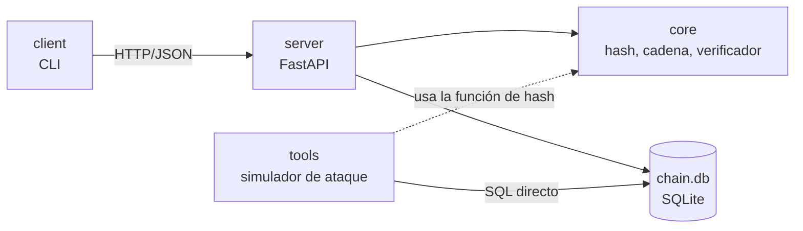

# PRD — CryptoCoin

> Documento de requisitos del producto. Sirve para **entender y mantener** el proyecto: qué se construye, por qué, qué se decidió y cómo se modifica.
> Es un documento para personas: los agentes de GPT trabajan con `SPEC.md` y no leen este archivo.
> Si hay conflicto técnico, manda `SPEC.md`. Si hay conflicto de alcance o propósito, manda este documento.

| | |
|---|---|
| **Proyecto** | CryptoCoin: base de datos encadenada con hash (mini-blockchain) |
| **Materia** | IH063 – Criptografía, Universidad de Guadalajara, CU Tonalá |
| **Responsable** | [AUTOR] |
| **Fecha de entrega** | [COMPLETAR] |
| **Versión del PRD** | 1.0 |

---

## 1. Resumen

CryptoCoin es una aplicación que registra transferencias de una criptomoneda básica en una base de datos donde **cada registro incluye un hash que depende del registro anterior**. Si alguien modifica un registro pasado, la cadena de hashes se rompe y la aplicación lo detecta e indica exactamente qué bloques fueron alterados.

No es una blockchain completa: no tiene consenso distribuido, minería ni red P2P. Simula únicamente la idea central del encadenamiento por hash.

## 2. Contexto y objetivos

### 2.1 Objetivos de aprendizaje (del proyecto de la materia)

1. Usar un hash criptográfico (SHA-256) sobre registros de datos.
2. Diseñar una estructura que encadene registros mediante el hash del anterior.
3. Detectar modificaciones verificando la cadena.
4. Documentar funcionamiento, supuestos, limitaciones y mejoras.

### 2.2 Objetivos del producto

- **O1.** Cumplir al 100% los requerimientos mínimos y los entregables de la materia.
- **O2.** Que el responsable pueda **explicar todo el código oralmente** (condición de autoría).
- **O3.** Que el proyecto se pueda mantener y ampliar (firmas, otro almacenamiento) sin reescribirlo.
- **O4.** Construirlo con un flujo de agentes de GPT (orquestador, manager, workers) gastando pocos tokens.

### 2.3 No objetivos

Consenso, minería o prueba de trabajo, red P2P, wallets y llaves, firmas digitales, interfaz gráfica o web, bases de datos externas (MongoDB, D1) y cualquier dependencia fuera de las permitidas en `SPEC.md` §8.

## 3. Usuarios

| Usuario | Qué necesita |
|---|---|
| **Operador de la demo** (el responsable) | Agregar, mostrar y verificar la cadena; simular un ataque y ver la detección; repetir la demo con facilidad |
| **Evaluador** (el profesor) | Ver los requisitos cumplidos, leer un informe claro y comprobar que el autor entiende su código |
| **Mantenedor** (el responsable en el futuro) | Entender decisiones, ubicar dónde cambiar cada cosa y ampliar sin romper el contrato |

## 4. Historias de usuario y criterios de aceptación

| ID | Historia | Criterio de aceptación |
|---|---|---|
| US-01 | Como operador quiero **agregar una transferencia** para que quede registrada en la cadena | Dado un emisor con saldo, cuando envío una transferencia válida, se crea un bloque con `id`, `timestamp`, `prev_hash` y `hash` correctos |
| US-02 | Como operador quiero **rechazar transferencias inválidas** | Monto no positivo, mismo emisor y receptor, cuenta vacía o saldo insuficiente producen un error claro y **no crean bloque** |
| US-03 | Como operador quiero **ver toda la cadena** con sus hashes | Se listan todos los bloques en orden con todos sus campos |
| US-04 | Como operador quiero **verificar la integridad** | Una cadena íntegra se reporta válida; una alterada lista **todos** los bloques con problemas, con su código y valores esperado y encontrado |
| US-05 | Como operador quiero que los **datos persistan** | Tras reiniciar el servidor, los bloques siguen y la cadena verifica igual; el génesis no se duplica |
| US-06 | Como operador quiero **simular un ataque** | Una herramienta independiente altera un registro directamente en el archivo de la base de datos; la siguiente verificación lo detecta sin reiniciar nada |
| US-07 | Como operador quiero **consultar el saldo** de una cuenta | Devuelve la suma de lo recibido menos lo enviado; una cuenta desconocida tiene saldo 0 |
| US-08 | Como evaluador quiero un **informe de 4 a 6 páginas** con capturas | El informe sigue la plantilla del profesor e incluye las 4 capturas pedidas, limitaciones y mejoras |
| US-09 | Como mantenedor quiero **saber dónde cambiar cada cosa** | Cada componente tiene una responsabilidad única documentada en `ARQUITECTURA.md` |

## 5. Requisitos funcionales

Resumen de `SPEC.md` §3. El contrato exacto (campos, fórmula, errores, API) está en el SPEC.

| ID | Requisito | Historia |
|---|---|---|
| F1 | Agregar un bloque al final de la cadena | US-01, US-02 |
| F2 | Mostrar todos los bloques en orden con sus hashes | US-03 |
| F3 | Verificar integridad y reportar todos los hallazgos | US-04 |
| F4 | Persistir en SQLite | US-05 |
| F5 | Simular un ataque con una herramienta independiente | US-06 |
| F6 | Consultar saldo de una cuenta | US-07 |

## 6. Requisitos no funcionales

| Atributo | Requisito |
|---|---|
| **Determinismo** | La misma entrada siempre produce el mismo hash; la serialización canónica vive en un solo lugar (`core`) |
| **Corrección** | Los vectores de referencia de `SPEC.md` §6 pasan exactamente |
| **Portabilidad** | Funciona en Windows, macOS y Linux con Python 3.10 o superior |
| **Simplicidad** | `core` usa solo la biblioteca estándar; pocas dependencias y fijadas en versión |
| **Atomicidad** | Agregar un bloque es atómico: peticiones simultáneas no bifurcan la cadena |
| **Frescura** | El servidor nunca guarda la cadena en caché; verifica siempre el estado actual del archivo |
| **Mantenibilidad** | Código comentado en español, nombres claros, un módulo por responsabilidad, sin refactorizar lo que ya pasa sus pruebas |
| **Usabilidad** | Mensajes claros en español con ✅ y ❌; error legible si el servidor no responde |
| **Rendimiento** | No es crítico; se espera uso con decenas o cientos de bloques |

## 7. Arquitectura de alto nivel

Monorepo con cuatro componentes. La propuesta detallada la hace Astra en `ARQUITECTURA.md`; esta es la visión que debe respetar.



| Componente | Responsabilidad | Puede importar |
|---|---|---|
| `core` | Lógica pura: bloque, hash, reglas de transacción, verificador, interfaz `Storage` | Solo la biblioteca estándar |
| `server` | API HTTP e implementación SQLite de `Storage` | `core` |
| `client` | CLI con menú; habla con el servidor solo por HTTP | Librería HTTP; nunca `core` |
| `tools` | Simulador de ataque y reinicio de la demo | `core` (solo el hash) y `sqlite3` |

**Por qué así:** `core` no sabe de red ni de base de datos, así que se prueba sola y es lo que se califica. Si el servidor diera problemas, se puede entregar un CLI que use `core` directamente. El simulador de ataque no pasa por la API porque modela a un atacante con acceso al archivo, que es el caso que el proyecto quiere demostrar.

Estructura de carpetas (fija):

```
CryptoCoin/
├── docs/        documentación
├── core/        lógica pura
├── server/      API y almacenamiento
├── client/      CLI
├── tools/       simulador de ataque y reinicio
├── tests/       core/ y server/
├── requirements.txt
├── requirements-dev.txt
└── .gitignore
```

## 8. Modelo de datos y reglas de dominio

**Bloque:** `id`, `timestamp` (UTC), `data` (`{from, to, amount}`), `prev_hash`, `hash`.

```
hash = SHA-256( id | timestamp | data_en_JSON_canónico | prev_hash )
```

- **Génesis:** `id = 0`, `prev_hash` de 64 ceros, transacción nula. Se crea sola si la base está vacía.
- **Modelo de cuentas:** el saldo de una cuenta es lo recibido menos lo enviado. Es más simple que el modelo UTXO de Bitcoin.
- **Montos enteros positivos**, sin decimales, para evitar errores de redondeo.
- **`SYSTEM`** es el único emisor que puede crear monedas; así existe saldo sin necesidad de minería.

## 9. API (resumen)

| Método y ruta | Función |
|---|---|
| `POST /transactions` | Crea un bloque con una transferencia (`422` si es inválida) |
| `GET /chain` | Lista todos los bloques |
| `GET /verify` | Devuelve validez, número de bloques y lista de hallazgos |
| `GET /balance/{cuenta}` | Saldo de una cuenta |
| `GET /health` | Estado del servidor |

No existe ningún endpoint que modifique o borre bloques.

## 10. Modelo de amenazas: qué se detecta y qué no

Esta tabla es clave para el informe y la defensa oral.

| Ataque | ¿Se detecta? | Cómo |
|---|---|---|
| Modificar el contenido de un bloque sin tocar su hash | Sí | `HASH_MISMATCH` en ese bloque |
| Modificar el contenido **y** recalcular el hash de ese bloque | Sí, si hay bloque siguiente | `LINK_BROKEN` en el siguiente |
| Modificar el **último** bloque y recalcular su hash | **No** | Ningún bloque posterior lo contradice |
| Borrar un bloque intermedio | Sí | `ID_GAP` y `LINK_BROKEN` |
| **Truncar** la cadena (borrar los últimos bloques) | **No** | La cadena más corta sigue siendo consistente |
| Insertar un bloque falso en medio | Sí | `ID_GAP` o `LINK_BROKEN` |
| Inyectar una transferencia sin saldo y reescribir los hashes siguientes | Sí | `INSUFFICIENT_BALANCE` (revisión semántica) |
| Reescribir consistentemente **todos** los hashes desde un bloque | **No** | No hay ancla externa, firma ni consenso |

Los tres "No" son las limitaciones que el informe debe reconocer. Las mejoras que los resolverían son: firmas digitales, publicar periódicamente el hash del último bloque en un medio externo, replicación en varios nodos y prueba de trabajo.

## 11. Métricas de éxito

| Métrica | Meta |
|---|---|
| Rúbrica de la materia | 100 puntos (diseño 20, hash y encadenamiento 25, verificación 25, persistencia y usabilidad 10, informe 15, código 5) |
| Pruebas automatizadas | 100% pasan en los tres gates |
| Vectores de referencia | Coinciden exactamente |
| Demo de extremo a extremo | Arrancar servidor → agregar → mostrar → verificar → atacar → verificar, sin errores |
| Defensa oral | El responsable explica cada archivo y modifica algo pequeño sin ayuda |

## 12. Plan de entrega por fases

| Fase | Contenido | Compuerta |
|---|---|---|
| 0 | Astra lee `SPEC.md` y escribe `ARQUITECTURA.md` con los briefs | El responsable da su "ok" |
| 1 | `core` y `tests/core` | **Gate 1:** pruebas del núcleo y vectores pasan |
| 2 | `server`, `tools` y `tests/server` | **Gate 2:** pruebas del servidor pasan; el ataque funciona |
| 3 | `client` y demo de extremo a extremo | **Gate 3:** la secuencia completa funciona |
| 4 | Revisión de Astra contra la rúbrica | Lista de defectos resuelta (máx. 2 rondas) |
| 5 | Documentación: `README`, `EXPLICACION`, actualización del `INFORME` | Documentos revisados |
| 6 | Capturas reales, exportar PDF y ensayo de la defensa | Entrega |

## 13. Riesgos y mitigaciones

| Riesgo | Mitigación |
|---|---|
| Agentes serializan distinto y la verificación falla sin alteración | Fórmula única en `core` y vectores de referencia como pruebas |
| Código generado que el responsable no entiende (falta de autoría) | `EXPLICACION.md`, preguntas de práctica y modificar algo pequeño antes de entregar |
| Servidor con caché no ve un ataque directo a la base | Regla de "sin caché" y prueba que altera el archivo y llama a `/verify` |
| Choques entre agentes que trabajan en paralelo | Una rama y una carpeta por módulo; fusionar solo tras el gate |
| Referencias inventadas en el informe | Solo fuentes verificables; lo dudoso se marca `[VERIFY]` y se revisa a mano |
| Consumo excesivo de tokens | Briefs de máximo 40 líneas, reportes de máximo 5 líneas, 2 rondas de corrección, orquestador solo en fases 0 y 4 |
| Tiempo insuficiente | `core` primero: es lo que se califica y permite entregar sin servidor |

## 14. Entorno

- **Sistema:** Windows con PowerShell (el código debe funcionar también en macOS y Linux).
- **Lenguaje:** Python 3.10 o superior, con entorno virtual (`.venv`).
- **Dependencias:** FastAPI, uvicorn y httpx en ejecución; pytest en desarrollo.
- **Archivos que no se versionan:** `chain.db`, `.venv/`, `__pycache__/`, `.pytest_cache/`.

## 15. Mapa de documentos

| Documento | Para qué sirve | Idioma | Quién lo escribe |
|---|---|---|---|
| `SPEC.md` | Contrato técnico para los agentes | Inglés | Responsable (con Claude) |
| `PRD.md` | Entender y mantener el proyecto | Español | Responsable (con Claude) |
| `ORQUESTADOR.md` | Prompt de Astra | Inglés | Responsable (con Claude) |
| `ARQUITECTURA.md` | Diseño técnico detallado y briefs | Español | Astra |
| `README.md` | Instalar, ejecutar y probar | Español | Workers rápidos |
| `INFORME.md` | Informe técnico para el profesor | Español | Borrador existente; se completa al final |
| `EXPLICACION.md` | Defensa oral | Español | Manager, y el responsable lo estudia |
| `modulos/CORE.md`, `SERVER.md`, `API.md`, `CLIENT.md`, `TOOLS.md` | Documentación viva de cada componente y referencia de la API | Español | El worker que crea o cambia el componente, en la misma tarea |
| `CHANGELOG.md` | Registro de cambios, una línea por cambio | Español | Cada worker, junto con su documento |

Jerarquía ante conflictos: `SPEC.md` (técnico) > `ARQUITECTURA.md` (detalle) > resto.

## 16. Decisiones tomadas

| Decisión | Alternativa descartada | Motivo |
|---|---|---|
| Monorepo con `core`, `server`, `client` y `tools` | Monolito de un solo paquete | Separa responsabilidades y sirve para aprender; el núcleo sigue siendo independiente |
| SQLite | MongoDB o Cloudflare D1 | La prueba de alteración necesita editar el archivo a mano; sin credenciales ni internet en la demo |
| Modelo de cuentas | UTXO | Más simple de explicar y de implementar |
| Montos enteros | Decimales | Evita errores de redondeo |
| Emisor `SYSTEM` | Minería | Da saldo inicial sin implementar minería |
| Ataque como herramienta externa | Endpoint de la API | Modela a un atacante con acceso al archivo; la API no se deja alterar a sí misma |
| Servidor sin caché | Caché en memoria | Un ataque directo a la base debe verse en la siguiente verificación |
| `core` solo con biblioteca estándar | Usar librerías externas | Menos dependencias y más fácil de explicar |
| Informe en español | Inglés | Lo evalúa un profesor hispanohablante; confirmar con él |

## 17. Cómo mantener y ampliar

**Para cambiar una regla de negocio** (por ejemplo, montos mínimos): editar `SPEC.md` §2.3, luego `core`, luego sus pruebas, y por último la sección correspondiente de este PRD.

**Para añadir un nuevo tipo de hallazgo en la verificación:** agregar el código en `SPEC.md` §4, implementarlo en `core`, agregar su prueba y añadirlo a la tabla del informe.

**Para cambiar de almacenamiento** (D1, MongoDB): implementar la interfaz `Storage` en `server`, sin tocar `core`; ejecutar de nuevo las pruebas del servidor.

**Para añadir firmas digitales:** extender el bloque con `signature` y `public_key`, definir en el SPEC qué se firma, y verificar la firma en `core`. Es la mejora más natural del proyecto.

**Para documentar un cambio:** todo endpoint, comando, opción, código de error o variable de entorno nuevo debe aparecer en su documento de `docs/modulos/` antes de dar la tarea por terminada, y debe sumar una línea a `CHANGELOG.md`. Una compuerta no se aprueba si el documento del módulo no existe o no coincide con el código.

Regla general: **cambiar primero el SPEC, luego el código**. Si el código y el SPEC discrepan, el código está mal hasta que se demuestre lo contrario.

## 18. Glosario

| Término | Significado |
|---|---|
| **Hash** | Resumen de longitud fija (256 bits en SHA-256) de unos datos; cualquier cambio produce un resumen distinto |
| **Efecto avalancha** | Un cambio mínimo en la entrada altera radicalmente el hash |
| **Bloque** | Un registro de la cadena: id, marca de tiempo, datos, hash anterior y hash propio |
| **Génesis** | Primer bloque de la cadena, con `prev_hash` de ceros |
| **Cadena** | Secuencia de bloques enlazados por `prev_hash` |
| **Encadenamiento** | Incluir el hash del bloque anterior en el cálculo del hash del actual |
| **Verificación** | Recalcular los hashes y comprobar los enlaces de toda la cadena |
| **Serialización canónica** | Forma única y fija de convertir los datos a texto antes de hashear |
| **Modelo de cuentas** | El saldo se calcula como lo recibido menos lo enviado por cuenta |
| **UTXO** | Modelo de Bitcoin basado en salidas de transacción no gastadas; no se usa aquí |
| **Ancla externa** | Dato publicado fuera del sistema que permite detectar una reescritura completa |
| **Gate** | Compuerta: condición de pruebas que debe cumplirse antes de pasar a la siguiente fase |
| **Monorepo** | Un solo repositorio que contiene varios componentes |